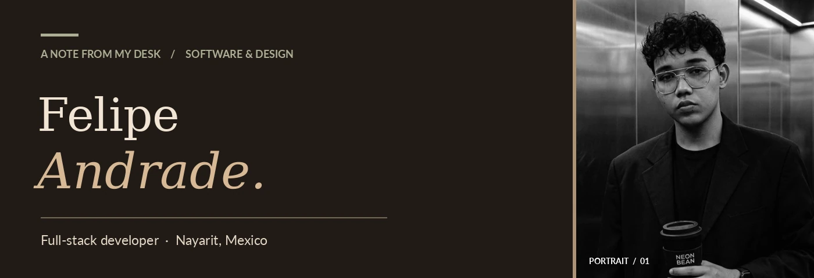
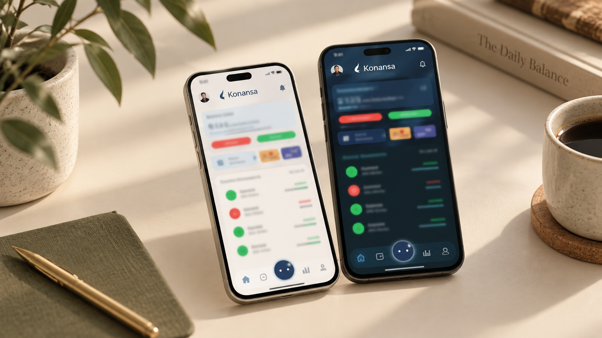
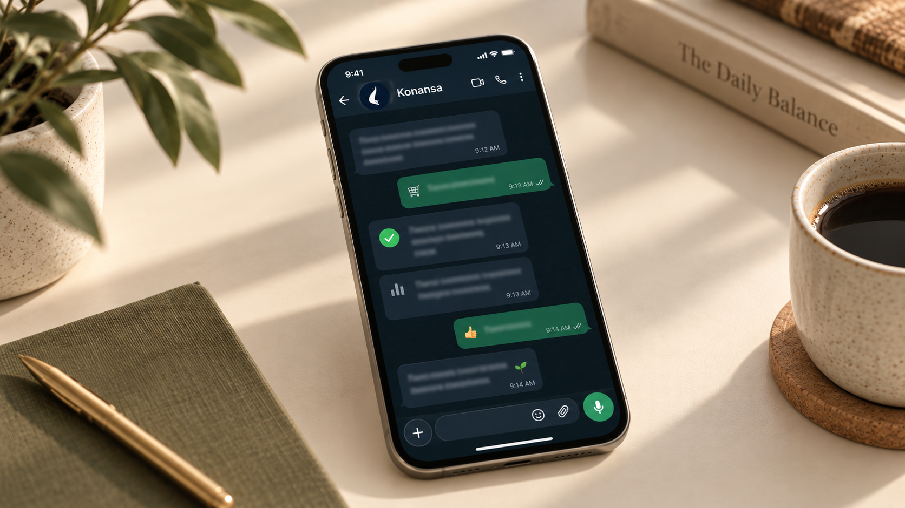
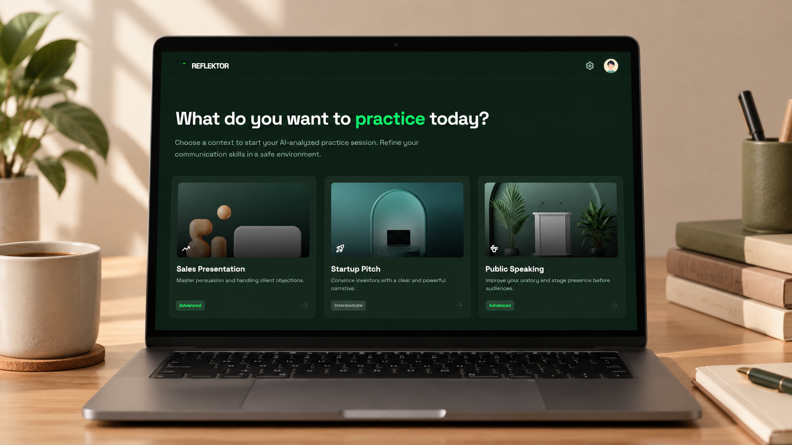
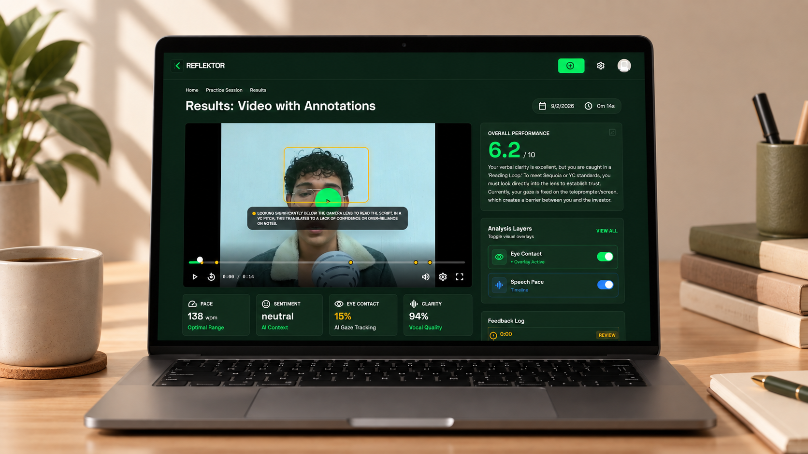
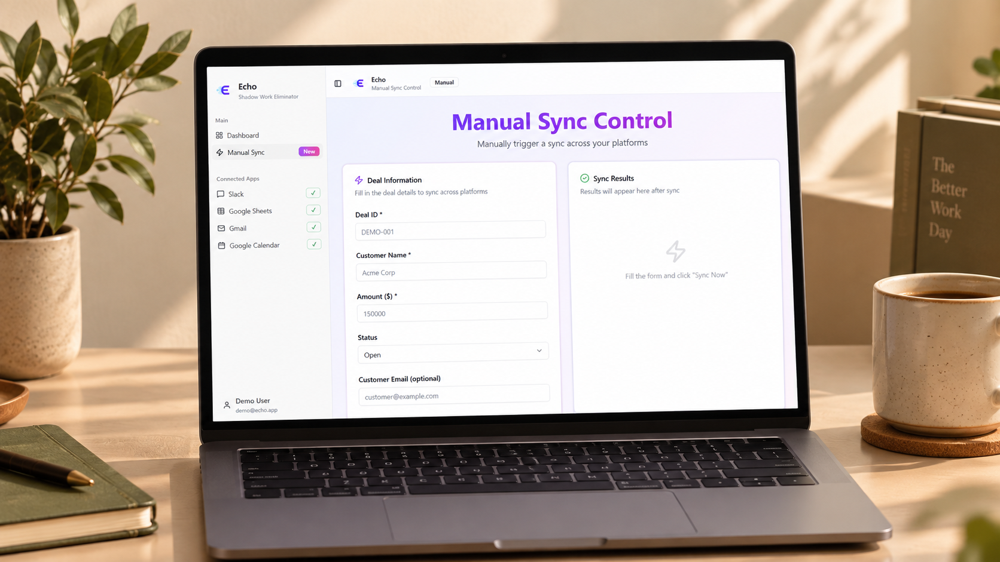
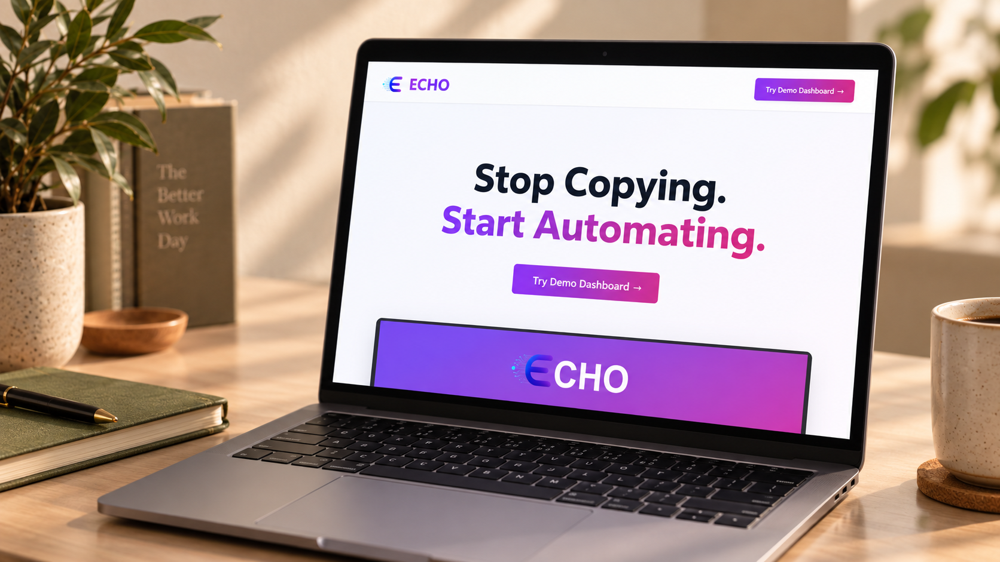
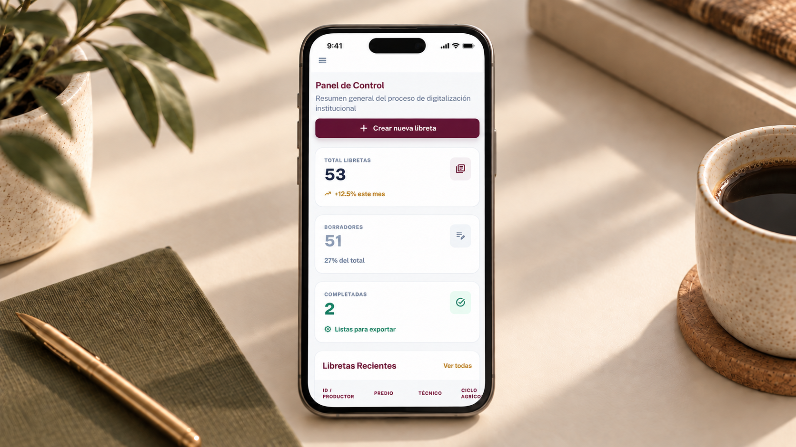
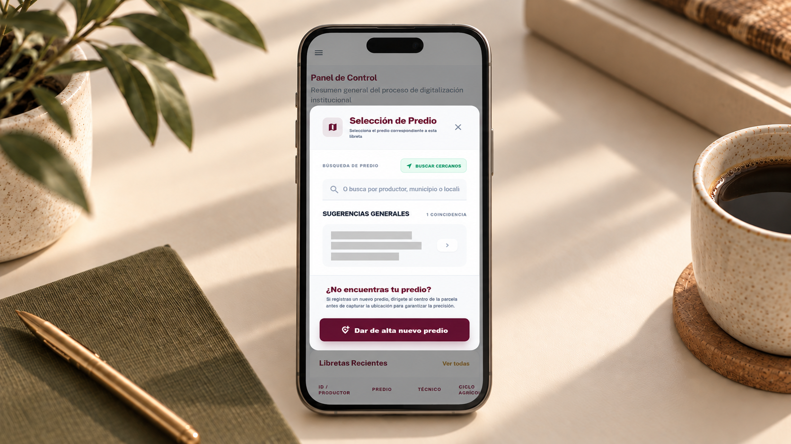

<!-- Felipe Andrade · GitHub profile · Quiet editorial / personal field notes -->

  

  
  
  

## 01 — A little about me

I’m a **Software Development and Management Engineering student** from Nayarit, Mexico. I enjoy understanding how things work, turning complex problems into clear interfaces, and continuously improving the details that make software useful.

I focus on **full-stack web development**, especially **Next.js, React, JavaScript and TypeScript**. My work includes a personal finance application, an independent AI project and technical coordination in a university development team.

**Currently** — Exploring ideas through personal and collaborative projects.  
**Open to** — Paid software engineering internships starting **January 2027** (official university internship: January–April 2027).

## 02 — Things I build with

   
  

Frontend & interfaces · APIs & serverless functions · Databases · Testing & delivery

## 03 — Selected work

<table>
<tr><td width="49%" valign="top">

<h3>01 / Konansa</h3>

<b>Full-Stack Developer Intern · Wallavi</b>

Contributed to a personal finance web application, building frontend components with Next.js and TypeScript and backend serverless functions. Applied Jest, debugging and code reviews.

<code>Next.js</code> <code>TypeScript</code> <code>Serverless</code>

More from Konansa

</td><td width="49%" valign="top">

<h3>02 / Reflektor</h3>

<b>Solo project · Gemini 3 Hackathon</b>

Built an AI presentation coach that analyzes eye contact, pacing, filler words and body language, then offers video feedback and personalized guidance through an AI chat coach.

<code>AI</code> <code>Gemini API</code> <code>Video processing</code>

Presentation results

</td></tr>
<tr><td width="49%" valign="top">

<h3>03 / Echo</h3>

<b>Team project · IBM watsonx Hackathon</b>

Created the project concept and helped shape its workflows and initial architecture, collaborating with a team to deliver a functional automation prototype under time constraints.

<code>Automation</code> <code>Workflow design</code>

More from Echo

</td><td width="49%" valign="top">

<h3>04 / Digital Field Notebook</h3>

<b>Technical coordination & frontend · University project</b>

Coordinate technical tasks in a student team and build responsive Angular interfaces for digitizing agricultural field records for a real client.

<code>Angular</code> <code>Frontend</code> <code>Coordination</code>

Field records

</td></tr>
</table>

<a href="https://felipe-andrade-portfolio.vercel.app/"><b>Explore more projects in my portfolio ↗</b></a>

## 04 — Experience & education

**Wallavi** · Full-Stack Developer Intern · *May–August 2025*  
**Universidad Tecnológica de la Costa** · Software Development and Management Engineering · *Expected 2027*  
**Recognition** · Best internship project in my cohort · GPA 9.9/10  
**Certifications** · AWS SimuLearn: Cloud Foundations · Linux Fundamentals (Cisco)

## 05 — On GitHub

  

  
  

Activity cards reflect public GitHub contributions, not the full scope of my experience. Dynamic cards depend on an external service.

---

<i>Good software begins with curiosity.</i>  <a href="https://felipe-andrade-portfolio.vercel.app/">Portfolio</a> · <a href="https://www.linkedin.com/in/felipe-andrade-hernandez/">LinkedIn</a> · <a href="mailto:andradehernandezfelipe@gmail.com">Email</a>

 

  

  
<i>Thanks for stopping by. ☕</i>

